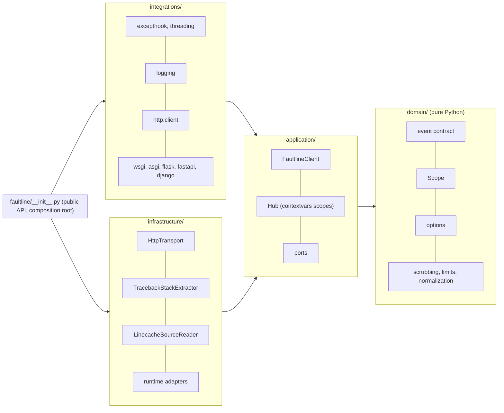
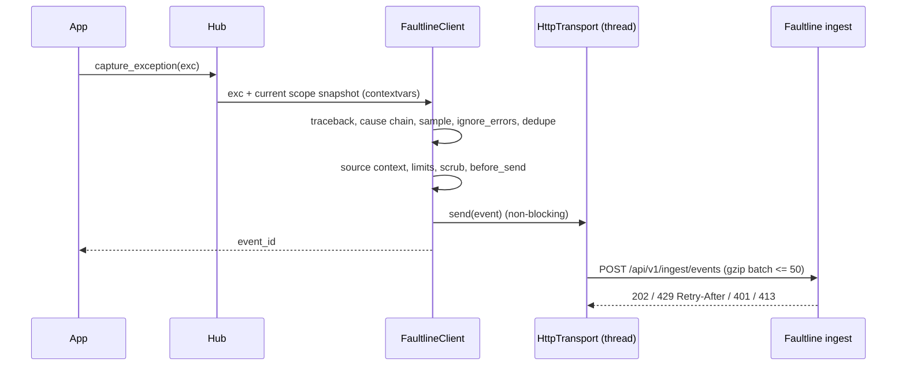

# getfaultline

The Python SDK for [Faultline](https://www.faultsline.dev), a self-hostable error-tracking
platform. It captures exceptions and messages, adds context (tracebacks with source,
breadcrumbs, request data, user, tags), scrubs secrets, and sends batched, gzip-compressed
events to the Faultline ingest API.

- **No runtime dependencies.** Uses only the standard library (`urllib`, `gzip`, `threading`,
  `contextvars`, `linecache`).
- **Never crashes your app.** Every public function is exception-safe, and internal errors are
  logged only when `debug=True`.
- **Typed** (`py.typed`, `mypy --strict` clean). Runs on Python **3.9 to 3.14**.
- **Async-safe and thread-safe scopes** built on `contextvars`.

## Quickstart

```bash
pip install getfaultline
```

```python
import faultline

faultline.init(
    api_key="flt_ingest_...",  # or os.environ["FAULTLINE_API_KEY"]
    environment="production",
    release="api@1.4.2",
)

try:
    do_risky_thing()
except Exception:
    faultline.capture_exception(tags={"feature": "checkout"})  # defaults to sys.exc_info()

faultline.capture_message("Payment webhook retried", "warning")
```

Uncaught exceptions (main thread and other threads) are captured automatically, and queued
events are flushed when the interpreter exits.

## API

| Function | Description |
| --- | --- |
| `init(api_key=..., **options)` | Configure the SDK. Calling it again replaces the previous client. |
| `capture_exception(exc=None, *, tags, extra, user, level, fingerprint, contexts)` | Capture an exception. `exc` defaults to the exception being handled (`sys.exc_info()`); an `exc_info` tuple or any other value also works. Returns the `event_id`, or `None` when dropped or disabled. |
| `capture_message(message, level="info", *, tags, extra, user, fingerprint, contexts)` | Capture a message. |
| `set_user({"id", "email", "username", "ipAddress"})` / `set_user(None)` | Set or clear the user on the current scope. |
| `set_tag(key, value)` / `set_tags({...})` | Searchable string tags. |
| `set_context(name, {...})` / `set_extra(key, value)` | Structured context or arbitrary extra data. |
| `add_breadcrumb(type=, category=, message=, level=, data=)` | Manual breadcrumb (also accepts a dict). `type` is one of `default`, `http`, `log`, `query`, `navigation`. |
| `with with_scope() as scope:` | Fork the current scope. Changes apply only inside the block, including asyncio tasks created inside it. |
| `flush(timeout=2.0)` | Block until queued events are sent. Returns `False` on timeout and never raises. |
| `close(timeout=2.0)` | Flush, remove the integrations, and disable the SDK. |
| `is_enabled()` / `get_current_scope()` | Introspection helpers. |

`set_user`, `set_tag`, `set_context`, `set_extra` and `add_breadcrumb` write to the **current**
scope. Outside a request or `with_scope()` that is the global scope. Inside one, it is the
forked scope.

```python
with faultline.with_scope() as scope:
    scope.set_tag("job", "nightly-export")
    faultline.set_user({"id": "42"})
    run_job()  # anything captured here carries the tag and user
# back to the previous scope here
```

## Options

| Option | Type | Default | Description |
| --- | --- | --- | --- |
| `api_key` | `str` | **required** | Public ingest key (`flt_ingest_...`). Sent as `X-Faultline-Key`. |
| `endpoint` | `str` | `https://www.faultsline.dev` | Base URL of the Faultline server. Override it when self-hosting. |
| `environment` | `str` | `None` | e.g. `production`, `staging`. |
| `release` | `str` | `None` | e.g. `api@1.4.2` or a git sha. |
| `server_name` | `str` | `socket.gethostname()` | Reported as `serverName`. |
| `sample_rate` | `float` 0..1 | `1.0` | Fraction of events to send. |
| `max_breadcrumbs` | `int` | `50` | Breadcrumbs kept per scope (capped at 100). |
| `send_default_pii` | `bool` | `False` | When `False`, the user IP and the `cookie`, `set-cookie`, `authorization`, `proxy-authorization`, `x-forwarded-for`, `x-real-ip` and `forwarded` headers are removed. |
| `before_send` | `(event) -> event \| None` | `None` | Modify or drop (`None`) an event. Runs after scrubbing. If it raises, the event is dropped. |
| `ignore_errors` | `list[str \| re.Pattern \| type[BaseException]]` | `[]` | Strings match as substrings and patterns are searched, both against the exception type, the message and `"Type: message"`. Exception classes match with `isinstance`. |
| `integrations` | `dict` | all `True` | `{"excepthook", "threading", "logging", "http"}` mapped to `True`, `False` or a configured instance (see below). |
| `enabled` | `bool` | `True` | `False` turns the SDK into a no-op (`api_key` is then not required). |
| `debug` | `bool` | `False` | Print SDK internals (dropped events, retries, invalid options) to stderr. |

Invalid options never raise:

- An invalid optional value falls back to its default.
- A missing `api_key` or an unusable `endpoint` disables the SDK.
- Run with `debug=True` to see why.

### Built-in integrations

- **excepthook**: `sys.excepthook` captures uncaught exceptions at level `fatal`, flushes for
  up to 2 s, then calls the previous hook, so the traceback is still printed and the exit code
  is unchanged. `KeyboardInterrupt` is ignored.
- **threading**: `threading.excepthook` captures exceptions that escape a thread (level
  `error`), then calls the previous hook.
- **logging**: log records at `INFO` and above become `log` breadcrumbs. Records with
  `exc_info` at `ERROR` and above can also be captured as events, which is off by default:

  ```python
  from faultline import LoggingIntegration

  faultline.init(
      api_key=...,
      integrations={
          "logging": LoggingIntegration(capture_errors=True, breadcrumb_level=logging.DEBUG)
      },
  )
  ```

  The integration wraps `logging.Logger.callHandlers`, so it needs no handler and never
  changes your logging configuration. The SDK's own `faultline` logger is ignored.
- **http**: outgoing `http.client` requests, which covers `urllib.request`, `urllib3` and
  `requests`, become `http` breadcrumbs (method, URL, status). The instrumentation is passive,
  and the SDK's own ingest requests are never recorded.

## Framework guides

Every framework integration forks a scope per request, attaches the request (method, URL,
headers, query; scrubbed as described below), adds a `request` breadcrumb, and captures
unhandled exceptions with `tags: {mechanism, handled: "no"}`. Framework packages are imported
lazily, only when you import the integration module.

### Flask

```python
from flask import Flask
import faultline
from faultline.integrations.flask import init_app

faultline.init(api_key=os.environ["FAULTLINE_API_KEY"])
app = init_app(Flask(__name__))
```

Unhandled exceptions that become a 500 are captured through Flask's `got_request_exception`
signal. `HTTPException` (`abort(404)`, 405, ...) is not captured. Runnable demo:
[`examples/flask_app.py`](examples/flask_app.py).

### FastAPI / Starlette

```python
from fastapi import FastAPI
import faultline
from faultline.integrations.fastapi import init_app

faultline.init(api_key=os.environ["FAULTLINE_API_KEY"])
app = init_app(FastAPI())  # same as app.add_middleware(FaultlineAsgiMiddleware)
```

`HTTPException` and exceptions handled by your exception handlers are not captured. Sync
endpoints that run in the threadpool keep the request scope. Runnable demo:
[`examples/fastapi_app.py`](examples/fastapi_app.py).

### Django

```python
# settings.py
import faultline

faultline.init(api_key=os.environ["FAULTLINE_API_KEY"], environment="production")

MIDDLEWARE = [
    "faultline.integrations.django.FaultlineMiddleware",  # first
    # ...
]
```

Works under WSGI and ASGI. Exceptions are captured through Django's `got_request_exception`
signal, so `Http404`, `PermissionDenied`, `BadRequest` and `SuspiciousOperation` are not
reported.

### Any ASGI or WSGI app

```python
from faultline.integrations.asgi import FaultlineAsgiMiddleware

app = FaultlineAsgiMiddleware(app)  # Quart, Litestar, raw ASGI, ...

from faultline.integrations.wsgi import FaultlineWsgiMiddleware

application = FaultlineWsgiMiddleware(application)  # Bottle, Pyramid, raw WSGI, ...
```

### Celery, scripts and serverless

The SDK delivers from a background daemon thread and flushes at interpreter exit. Workers
that are killed or frozen (serverless) should call `faultline.flush()` at the end of each
invocation.

## Self-hosting

Set `endpoint` to your server's base URL. The SDK posts to `{endpoint}/api/v1/ingest/events`:

```python
faultline.init(api_key="flt_ingest_...", endpoint="http://localhost:4000")  # local faultline-server
faultline.init(api_key="flt_ingest_...", endpoint="https://faultline.internal.example.com")
```

The examples read `FAULTLINE_API_KEY` and `FAULTLINE_ENDPOINT` (default
`http://localhost:4000`). Proxies configured with `HTTPS_PROXY` / `HTTP_PROXY` are honored.

## What gets sent

Each event follows the shared Faultline event contract: `eventId` (uuid v4), `timestamp`,
`level`, `platform: "python"`, `exception` (type, value, frames ordered oldest to newest,
`cause` chain), `message`, `tags`, `user`, `request`, `contexts` (`runtime`, `os`, plus your
own), `breadcrumbs`, `extra`, `fingerprint`, `environment`, `release`, `serverName`, and
`sdk: { name: "getfaultline", version }`.

- **Frames** come from the traceback, oldest to newest. A frame is `inApp` unless it lives
  under `site-packages` / `dist-packages`, the standard library, a synthetic file
  (`<frozen ...>`, `<string>`), or the SDK itself. In-app frames get +-5 lines of source
  context (`linecache`, so zip apps work too) and, on Python 3.11+, a column number.
- **Cause chain**: `__cause__`, otherwise `__context__` unless suppressed with
  `raise ... from None`. At most 5 exceptions in total; cycles are broken.
- **Exception groups** are reported as the group itself (its message lists the
  sub-exceptions) with the first sub-exception as its cause.
- **Non-exception values** passed to `capture_exception` become a synthetic `Error` with the
  caller's stack.

The SDK enforces the pinned limits before sending:

| Field | Limit |
| --- | --- |
| Frames | 100 (newest kept) |
| Breadcrumbs | 100 |
| Tags | 50 (key <= 32 chars, value <= 200 chars) |
| `message` / `exception.value` | 8192 chars |
| Source context | +-5 lines, each <= 300 chars |
| `exception.cause` chain | 5 exceptions in total |
| Batch | <= 50 events and <= 1 MB |

**Scrubbing (client side, same rules as the server and the Node SDK):**

- Values under keys matching
  `(authorization|cookie|set-cookie|password|passwd|secret|token|api[_-]?key|x-faultline-key)`
  (case-insensitive) become `"[Filtered]"`. This applies to request headers and query,
  `extra`, `contexts`, tags and breadcrumb data.
- Credit-card-like strings (`\b(?:\d[ -]*?){13,16}\b`) in request, `extra` and breadcrumb data
  are also filtered, as are sensitive URL query parameters.

**Delivery:**

- Events wait in an in-memory queue of at most 100 events; the oldest is dropped when full.
- A daemon worker thread sends a batch every 2 s, or as soon as 20 events are queued, gzip
  compressed. Each request times out after 5 s.
- Network errors, timeouts, `5xx` and `408` are retried with exponential backoff and jitter
  (up to 3 retries). A `429` pauses delivery for its `Retry-After`.
- A `401` or `413` response drops the batch. With `debug=True` the SDK logs the reason.
- At interpreter exit an `atexit` hook flushes for up to 2 s, then gives up. The SDK never
  keeps your process alive. After `os.fork()` the child starts a fresh worker.
- Identical consecutive errors within 1 s are sent once.

## Architecture

The SDK follows Clean Architecture. Dependencies point inward only, and
[import-linter](https://import-linter.readthedocs.io) enforces this in CI (plus an AST-based
test in `tests/test_architecture.py`).





See [ARCHITECTURE.md](ARCHITECTURE.md) for the decision log.

## Development

```bash
python3 -m venv .venv
.venv/bin/pip install -e ".[dev]" django
```

| Command | What it does |
| --- | --- |
| `ruff check . && ruff format --check .` | Lint and formatting. |
| `mypy` | Strict type checking of `src`, `tests` and `examples`. |
| `lint-imports` | Clean Architecture layer contracts. |
| `pytest` | Unit, contract-conformance (pydantic), local `http.server` transport, framework and subprocess tests. |
| `python -m build && twine check dist/*` | Build the sdist and wheel. |

### Releasing

1. Bump `src/faultline/_version.py` and add a `CHANGELOG.md` entry.
2. Tag `vX.Y.Z` and push the tag.
3. `.github/workflows/release.yml` runs the checks, builds, and publishes to PyPI with
   trusted publishing (no API token; configure the trusted publisher on PyPI once).

## License

MIT
